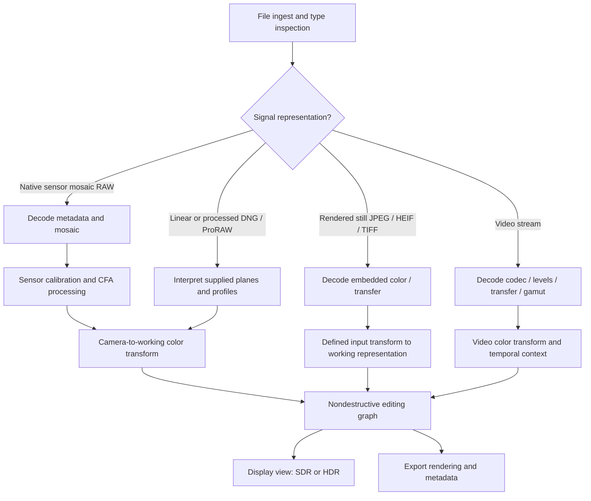

# Master Photography Knowledge Base — Version 2.0
## Research and Engineering Blueprint for Perception Editor and Future Capture Software

**Document ID:** MPKB-BLUEPRINT-2.0  
**Version:** 2.0.0 (blueprint; not the completed knowledge base)  
**Date:** 2026-10-21  
**Primary source:** `Master_Photography_Knowledge_Base.md`, version 1.0 (451 source-file lines; approximately 3,629 words)  
**Primary platform of interest:** Panasonic LUMIX DC-S5 (original model), with extendibility to LUMIX S and G cameras  
**Initial development target:** macOS / Apple Silicon, including an M1 MacBook Air with 8 GB unified memory as a resource-constrained reference system  
**Audience:** photography scientists, color scientists, camera engineers, macOS/iOS developers, test engineers, LLM research agents, and Codex agents  
**Status:** Approved structure proposed; research and measurements remain to be executed  

> **What this deliverable is:** A source-audited plan specifying *what must be researched*, *how to document it*, *how to translate research into engineering*, and *what constitutes verification*. It is **not** a claim that all algorithms, sensor behaviors, camera interfaces, benchmarks, or repository integrations have been researched or implemented. All implementation proposals are contingent on repository inspection, licensing review, testing, and available hardware.

---

## 0. Executive charter

### 0.1 Mission

Build a continuously maintainable, deeply technical photography science and image-processing knowledge base that enables Perception Editor and related capture software to:

1. Decode and interpret supported input files reliably and without hidden assumptions.
2. Produce accurate, consistent, controllable still photographs using physically informed and perceptually appropriate pipelines.
3. Offer responsive, nondestructive editing on constrained Apple Silicon hardware.
4. Extend validated approaches to Panasonic LUMIX video, iPhone images, and later other camera systems.
5. Evaluate genuine improvements against reproducible research baselines and contemporary commercial software.
6. Distinguish authentic signal recovery from modeled estimation and generative reconstruction.

**Success is not measured by document length or the number of advanced features described.** Success means reliable technical knowledge plus implementable contracts plus measurable validation.

### 0.2 Decisions carried forward from Version 1.0

- Keep the original historical → light/color → sensors → capture → optics → computation → editing → Panasonic → end-to-end → references progression.
- Still photography is the principal domain; explicit video/cinema extension notes remain mandatory.
- LUMIX is the initial camera family; use the **original** DC-S5 for the first complete field characterization.
- Benchmark Lightroom, Capture One, Photoshop/Adobe Camera Raw, darktable, RawTherapee, Apple's native RAW APIs, and applicable computational photography implementations without unproven claims of superiority.
- Preserve mathematical depth, failure modes, process diagrams, and engineering notes in every major topic.
- Maintain all Version 1.0 chapters as legacy provenance, even when Version 2.0 reorganizes material into smaller files.

### 0.3 What changes in Version 2.0

| Dimension | Version 1.0 | Required Version 2.0 outcome |
|---|---|---|
| Content | Ten concise surveys | Deep, independently retrievable topic modules and implementation specs |
| Claims | Usually uncited | Claim-level source IDs, source dates, and uncertainty status |
| Math | Illustrative formulas | Dimensional analysis, precise definitions, assumptions, equations, worked examples, tests |
| Algorithms | High-level steps | Pseudocode, input/output contracts, edge cases, complexity and benchmarks |
| Cameras | Family-level observations | Mode/firmware-specific S5 characterization and broader camera capability records |
| Processing | One generic pipeline | Separate RAW mosaic, linear-DNG/ProRAW, rendered still, video and multiframe pipelines |
| Engineering | Aspirational recommendations | Architecture decisions, testable milestones, performance budgets and constraints |
| Comparison | Qualitative claims | Matched-condition, traceable quality, performance and usability comparisons |
| LLM usage | Large Markdown chapter | Stable IDs, dependency maps, metadata headers, short retrieval units and agent task templates |

### 0.4 Non-goals and explicit limitations

- No claim of direct control over proprietary Panasonic sensor firmware, IBIS telemetry, internal ADC behavior, or inaccessible multi-shot frames.
- No assertion that every LUMIX model supports the same sensor, autofocus, ISO or stabilization behavior.
- No assertion that any single demosaicer, tone mapper, color appearance model, or neural architecture is optimal in all cases.
- No claim that a clipped channel or missing signal can be deterministically recovered from nonexistent measurements.
- No unsupported description of Perception Editor's current code or dependencies; the repository must first be inspected.
- No copyright, patent, code-license, or benchmark-license assumptions without review.
- No modification of the original Version 1.0 source file. This blueprint is a separate deliverable.

---

## 1. Research governance and evidence policy

### 1.1 Claim classification — mandatory

Tag important claims in research modules using these prefixes:

- **[V] Verified:** directly grounded in a cited primary specification, reproducible publication, repository source, or measurement with stated method.
- **[I] Inferred:** engineering judgment derived from specified facts; include reasoning and limitations.
- **[H] Hypothesis:** proposed improvement requiring comparative experiment.
- **[U] Unknown:** data not available or not yet validated, including proprietary camera implementation details.
- **[D] Decision:** engineering choice adopted with written alternatives and decision rationale.

Example: `[U] It is not established that a normal DC-S5 MP4 or MOV file contains time-aligned, accessible gyro records suitable for third-party stabilization.`

Each claim also receives an **evidence grade**: A = primary norm/spec or replicated measurement; B = reputable reviewed research; C = documented implementation or independent single measurement; D = secondary description/unconfirmed claim. A source's general reliability does not supersede a claim's actual support.

### 1.2 Source hierarchy

1. **Normative** — CIE, ISO/IEC, ITU-R, ICC, Adobe DNG specs, published API contracts, vendor technical manuals.
2. **Primary scientific research** — peer-reviewed papers with equations, datasets, supplementary methods and reproducible benchmarks.
3. **Source code / implementation** — tagged releases, commit IDs, tests, implementation docs, explicit licenses.
4. **Measured independent performance** — instrumented datasets, defined shooting modes, sample counts and raw data.
5. **Vendor marketing / secondary articles** — leads to investigate; never sole basis for precise engineering claims.

For each source: source ID; authors/issuer; title; release/revision/date; URL/DOI; accessed-on date; relevant sections; applicable hardware/firmware; license; key claims supported; contradictions and errata.

When a standard is paywalled, cite its official abstract/identifier and clearly mark which technical details still require licensed access. Do not invent inaccessible normative text.

### 1.3 Recency policy

- Standards, supported file formats and operating-system APIs: review at release milestones and prior to implementation.
- Camera firmware, supported model lists, decoder versions, library licenses and model capabilities: re-check whenever compatibility decisions are made.
- Research benchmarks: record the exact baseline implementation, date, dependency versions and settings.
- This blueprint is current to **21 October 2026**, only insofar as explicitly verified sources in the reference register support it. Research modules must carry their own last-verified dates.

### 1.4 Independent review gates

A topic cannot be marked `engineering-ready` until it passes all of:

1. Source/claim audit and mathematics review.
2. One executable scalar/CPU reference or fully specified external oracle.
3. Test vectors with expected results, tolerances and failure examples.
4. Domain/precision/color-space audit.
5. Data access and legal/license review.
6. Performance estimates and resource analysis, even if actual measurements are deferred.
7. Named dependency, proposed interface and traceability to requirements.

### 1.5 Threats to validity

Explicitly account for scene dependence, subjective image preference, unpublished commercial behavior, mismatch of automatic settings, vendor-processed RAW, model-specific noise calibration, lens-profile compensation, inaccessible telemetry, mismatched display transforms, data leakage in ML training, and overfitting to the S5.

---

## 2. Version 1.0 technical correction register

**All locations below refer to original Version 1.0 sections.** “Fix” indicates required research/document correction, not a conclusion about code that has not been inspected.

| ID | Source location | Issue | Required correction or investigation | Severity | Verification gate |
|---|---|---|---|---|---|
| COR-001 | Ch. 1, Ch. 3 and Ch. 10 dynamic range | Decibel formula labeled as stops | Define `DR_stops = log2(N_sat / sigma_read)` and `DR_dB = 20 log10(N_sat / sigma_read)`; explain thresholds and conventions | Critical | Dimensional/test-vector review |
| COR-002 | Ch. 1, film grain | Grain described as essentially photon Poisson statistics | Distinguish silver-halide granularity, development correlations, scanning noise and quantum statistics | High | Film sensitometry literature review |
| COR-003 | Ch. 2, gamma | sRGB simplified to a power law | Specify exact piecewise sRGB OETF/EOTF; separate BT.709, PQ, HLG, logarithmic camera encodings | Critical | Transfer-function round-trip vectors |
| COR-004 | Ch. 2, metamerism | Camera vs. observer mismatch lacks characterization method | Define camera spectral sensitivity measurement, illuminants, target reflectances and uncertainty | High | Multi-illuminant color test |
| COR-005 | Ch. 2, appearance models | “Full CAM16” implied as universally better | Compare CAM16-UCS, CIE Lab, JzAzBz, ICtCp, Oklab, and ACES 2 JMh for particular operations | High | Controlled color-rendering comparisons |
| COR-006 | Ch. 3, noise | Read noise, PRNU and total-noise ranges are unconditional | Declare exposure, ISO, mode, units, temperature, bandwidth and measurement conventions; model DSNU and correlated noise | Critical | EMVA-inspired PTC/dark/flat protocol |
| COR-007 | Ch. 3, ISO invariance | Description is oversimplified | Model upstream/downstream read noise, analog/digital gain, ADC quantization, and headroom | High | Exposure/gain sweep |
| COR-008 | Ch. 3, dual native ISO | Mixed with dual conversion gain and dual output gain | Keep technologies separate, with per-body evidence and no assumed access to two raw streams | Critical | Camera capability records |
| COR-009 | Ch. 4, camera pipeline | Describes white balance/demosaic as if intrinsic to sensor RAW | Separate capture-stage corrections, RAW payload, rendering ISP, metadata and optional in-camera processing | Critical | File-level truth tables |
| COR-010 | Ch. 4, CFA algorithms | Method taxonomy and relative quality too categorical | Classify MHC, AHD, LMMSE, RCD, AMaZE and learned methods with conditions and cited evidence | High | Matched comparison tests |
| COR-011 | Ch. 4, black level | Unqualified fixed values imply universal applicability | Decode tags/optical black samples; verify camera/ISO/mode differences and pedestal policies | High | S5 RAW parse and dark-frame checks |
| COR-012 | Ch. 5, stabilization | Gyro rate and stop claims generalized | Remove unverified fixed rates, distinguish CIPA claims from measured performance and file telemetry | High | Model/mode capability evidence |
| COR-013 | Ch. 5, diffraction | Formula lacks definition of Airy radius/diameter and wavelength | Define first-null radius in image plane `r = 1.22 lambda N` and sampling relation | Medium | Units and optical test |
| COR-014 | Ch. 6, multi-frame SNR | `sqrt(N)` presented too generally | State assumptions of independent noise, perfectly aligned stationary signal and unsaturated frames; model correlations and motion | High | Synthetic/noisy burst experiments |
| COR-015 | Ch. 6, sensor shift | 96 MP output conflated with availability of original exposures | Verify exact S5 file product, accessibility of per-shift frames, firmware and movement handling | Critical | S5 on-camera test matrix |
| COR-016 | Ch. 7, graph | “Fully invertible” and “linear throughout” not universally realizable | Preserve scene-referred linear working data when appropriate; allow operation-specific encodings and non-invertible edits | Critical | Explicit operator contracts |
| COR-017 | Ch. 7, AI | Quality assertions without benchmarks | Distinguish reconstruction from hallucination; document datasets, metrics, uncertainty and content authenticity controls | High | Blind tests plus provenance checks |
| COR-018 | Ch. 8, LUMIX family | Generalization of BSI, AF, DR, Dual Native ISO across bodies | Build verified per-model/per-firmware/per-mode capability table | Critical | Vendor manual + test files |
| COR-019 | Ch. 8/9, V-Log | Cinema log encoding conflated with still RAW | Maintain independent V-Log video and sensor-RAW pipelines; specify transfer functions and level mapping | Critical | Published Panasonic equations + vectors |
| COR-020 | Ch. 9, highlight recovery | Recovery phrasing obscures limits of clipping | Separate use of non-clipped channels, spatial/model-based estimates and unrecoverable scene information | Critical | Channel saturation synthetic tests |
| COR-021 | Ch. 10, sources | Source categories lack precise bibliographic details | Add source IDs, DOIs/URLs, publication/revision dates, relevant section, license and claim map | Critical | Reference audit |
| COR-022 | All chapters | “Current commercial limitations” are unmeasured | Convert to explicit benchmark questions with tested versions/settings, controls and failure criteria | High | Paired comparison report |

### 2.1 Required reference equations (starting examples, not exhaustive)

**Photon-to-electron image formation:**

\[
\mu_{e,c}(x,y) = t A_{\mathrm{pixel}}\int L_{\lambda}(x,y)\,T_{\mathrm{optics}}(\lambda,x,y)\,S_c(\lambda,x,y)\,\frac{\lambda}{hc}\,d\lambda
\]

Here the definition of `L_lambda` must specify radiometric geometry and units; the expression above is a conceptual starting point, not a complete radiometric camera calibration equation.

**Simplified electron-domain shot/read model:**

\[
n \sim \operatorname{Poisson}(\mu_e+\mu_d), \qquad y_e = n + \epsilon_r,\quad \epsilon_r\sim \mathcal{N}(0,\sigma_r^2)
\]

Correlated readout and PRNU/DSNU require extra modeled terms and actual measurements. Distributional assumptions must be tested.

**Dynamic range with read-noise floor:**

\[
DR_{\mathrm{stops}}=\log_2\!\left(\frac{N_{\mathrm{sat}}}{\sigma_{\mathrm{read}}}\right),\qquad DR_{\mathrm{dB}}=20\log_{10}\!\left(\frac{N_{\mathrm{sat}}}{\sigma_{\mathrm{read}}}\right).
\]

These are **engineering** definitions with a signal-to-noise ratio of one at the dark end. Photographic dynamic range must define its own usable-noise criterion.

**sRGB encoding, linear component `L`, encoded component `C`:**

\[
C(L)=\begin{cases}12.92L,&L\le0.0031308,\\1.055L^{1/2.4}-0.055,&L>0.0031308.\end{cases}
\]

Derive the inverse explicitly in Chapter 2, specify legal input range, out-of-range policy, scene/display relationship and treatment of negative working values.

---

## 3. Target knowledge library architecture

### 3.1 Logical layers

**Layer A — Science:** optical physics, sensor physics, color science, statistics, perceptual models and acquisition principles.

**Layer B — Algorithms:** independently testable mathematical methods; the evidence-based implementation alternatives for each major task.

**Layer C — Platform truth:** camera-specific file formats, firmware/mode behavior, codec support, lens profiles and verified API capabilities.

**Layer D — Engineering:** data contracts, runtime pipeline, nondestructive edit graph, CPU/GPU paths, tests and performance.

**Layer E — Product:** measurable user needs, competitive evaluation, prioritized Perception Editor features and capture-app roadmap.

Do not conflate these layers: a physics fact is not automatically a software decision, and a software proposal is not a proven sensor property.

### 3.2 Proposed physical folder layout

```text
master-photography-knowledge-base/
├── README.md
├── INDEX.md
├── CHANGELOG.md
├── AGENT_RETRIEVAL_GUIDE.md
├── DECISIONS.md
├── chapters/
│   ├── 01-historical-foundations/
│   ├── 02-light-color-science/
│   ├── 03-image-sensors/
│   ├── 04-capture-pipelines/
│   ├── 05-optics-and-lenses/
│   ├── 06-computational-photography/
│   ├── 07-raw-editing-algorithms/
│   ├── 08-lumix-platform/
│   ├── 09-end-to-end-systems/
│   ├── 10-glossary-formulas-references/
│   ├── 11-file-formats-metadata/
│   ├── 12-color-management-display/
│   ├── 13-image-engine-architecture/
│   ├── 14-machine-learning/
│   ├── 15-validation-benchmarks/
│   ├── 16-capture-and-camera-integration/
│   └── 17-perception-implementation/
├── engineering/
│   ├── specs/
│   ├── interfaces/
│   ├── architecture-decisions/
│   └── feasibility-investigations/
├── platform/
│   ├── panasonic/DC-S5/
│   ├── panasonic/other-models/
│   ├── iphone/
│   └── camera-support-matrix.md
├── test-plans/
│   ├── calibration/
│   ├── synthetic/
│   ├── image-quality/
│   ├── performance/
│   └── regression/
├── references/
│   ├── sources.md
│   ├── claim-registry.md
│   ├── data-licenses.md
│   └── bibliography.bib
├── datasets/
│   ├── MANIFEST.md
│   └── README.md
├── prompts/
│   ├── chapter-research-prompt.md
│   ├── engineering-spec-prompt.md
│   └── benchmark-review-prompt.md
└── legacy/
    └── Master_Photography_Knowledge_Base_v1.md
```

`datasets/` should hold manifests, checksums and retrieval instructions by default, **not** giant RAW collections checked into Git. Store large files in an appropriate local or artifact dataset store and track immutable hashes.

### 3.3 Stable naming and links

- Topic ID: `MPKB-<CHAPTER>-<NNN>` (e.g., `MPKB-07-014`).
- Algorithm ID: `ALG-<CATEGORY>-<NNN>` (e.g., `ALG-DEMO-001`).
- Engineering spec: `ENG-<SUBSYSTEM>-<NNN>`.
- Dataset: `DATA-<SOURCE>-<NNN>`.
- Test: `TEST-<SUBSYSTEM>-<NNN>`.
- Camera profile: `CAM-PAN-DC-S5-<MODE>-<REV>`.
- ADR: `ADR-<NNN>`.

Every module starts with minimal YAML metadata; see §9.2. All cross-links use these IDs and relative paths. Searchable aliases cover synonyms such as "color/colour," "RAW development/demosaicing," "PDR/DR," and camera model variants.

### 3.4 Granularity and retrieval rules

Target **one technical question or one implementable algorithm per Markdown file**. Long chapters are indexes into files rather than standalone giant documents. Do not split an equation from its definitions, assumptions, failure conditions or test cases. Keep tables short and link to evidence when measurement data becomes large.

Each module needs a 100–200-word summary, explicit prerequisites, claims/sources, mathematics, process, code-related notes, validation and unresolved questions. A module that cannot be understood independently is too fragmentary.

---
## 4. Complete Version 2.0 chapter specifications

For **every** topic in Chapters 1–17, the researcher must provide: overview; precise assumptions; mathematical foundations (units/notation); pseudocode or step process; parameters and experimentally justified ranges; failure modes; alternatives and trade-offs; LUMIX S5 notes where relevant; video extension; source/claim registry; implementation notes; testing and measurable acceptance criteria. A topic may mark an item `not applicable` with justification rather than inventing material.

### Chapter 01 — Historical foundations and photographic response

**Goal:** Preserve technically consequential film-era concepts without creating false equivalences between photographic emulsions and semiconductor sensors.

**Required modules**

- `01.01` Image formation and exposure history: pinhole, photographic lenses, shutters, exposure units, reciprocity.
- `01.02` Photochemical capture: silver halide, sensitometry, density, characteristic D–log H curves, shoulder/toe, reciprocity failure.
- `01.03` Grain structure, granularity, MTF, film scanning and sampling/aliasing.
- `01.04` Color film: spectral dye response, interlayer effects, masking, white-point assumptions.
- `01.05` From chemical development to linear electronic capture; what transfers and what does not.
- `01.06` Film emulation: tone response, dye cross-talk approximations, spatially varying grain statistics, halation and bloom with explicit physical-versus-artistic modes.

**Research questions:** Can a calibrated film response be represented by a scene-referred transform plus perceptual/synthetic effects? Which components cannot be reconstructed from ordinary digital RGB? How should physically measured grain be distinguished from stylized noise?

**Minimum artifacts:** response-curve notebook; units glossary; physically measured vs artistic film-emulation spec; at least three failure-case examples.

**Engineering gate:** No physical film-simulation claim without a reproducible model and reference material.

### Chapter 02 — Light, color science and perception

**Goal:** Define an unambiguous colorimetric foundation for input transforms, editing and output rendering.

**Required modules**

- `02.01` Radiometry/photometry and spectral distributions; geometric camera response, reflectance, SPD and observer models.
- `02.02` Standard observers and illuminants, XYZ, chromaticities, metamerism, color matching and limits of 3×3 camera matrices.
- `02.03` White balance, correlated color temperature, tint, chromatic adaptation, multipliers and mixed-illuminant estimation.
- `02.04` RGB spaces, primaries, white points, matrix derivations and adaptation choice.
- `02.05` Transfer functions: scene-linear, sRGB, Rec.709, camera log, ST 2084 PQ, HLG and Apple extended-range paths.
- `02.06` Appearance and perceptual spaces: CIELAB, CAM16(-UCS), JzAzBz, ICtCp, Oklab, and ACES 2 JMh; purpose-appropriate comparisons.
- `02.07` Tone-scale design, highlight shoulder, shadows, gamut mapping, hue skew and chroma compression.
- `02.08` Camera color characterization using dual/multi-illuminant targets, spectral uncertainty, DCP/ICC profile modeling.
- `02.09` Measurement: ΔE00 and alternative differences, gray balance, skin hue, saturation performance and uncertainty.

**Required equations:** spectral response integrals with units, standard observer integrations, chromatic adaptation matrices, exact forward/inverse transfers, matrix composition, invertibility and clipping conditions, gamut boundary rules.

**Research experiments:** paired high-CRI daylight/LED/tungsten captures, chart-patch calibration, skin and textile validation, display/viewing adaptation comparisons.

**Engineering gate:** mathematically reversible *transforms* pass round-trip tolerance; intentionally non-invertible tone/gamut mapping is documented as such.

### Chapter 03 — Digital sensors and noise engineering

**Goal:** Model sensor behavior as a measured input to the editor, not a camera-family marketing description.

**Required modules**

- `03.01` Pixel optics, microlenses, CFA spectral transmission, photodiodes, FSI/BSI architectures.
- `03.02` Full well, charge transfer, conversion gain, ADC architectures and quantization.
- `03.03` Shot noise, read noise, dark current, hot pixels, DSNU, PRNU, color/row/column correlations, thermal behavior.
- `03.04` PTC, dark/flat acquisition, statistical uncertainty and EMVA 1288 linear/general methodology.
- `03.05` ISO gain, dynamic-range definitions, dual conversion gain, dual native ISO and dual output gain **as distinct concepts**.
- `03.06` CFA and sensor format geometry, sampling, pixel pitch, fill factor, Nyquist behavior.
- `03.07` Readout speed, mechanical/electronic shutters, rolling shutter, banding and flicker.
- `03.08` S5 still RAW behavior by firmware, file mode, ISO and shutter mode.

**Required math:** Poisson–Gaussian models, conversion from electrons to digital numbers, variance propagation, noise covariance, saturation, quantization, effective SNR and DR with definition-specific thresholds.

**Research experiments:** repeated paired dark frames/flat fields, ISO sweep, exposure sweep, temperature annotations, row/column noise analysis, saturation detection, high-ISO transition check.

**Engineering gate:** model parameters have source data, uncertainty estimates, applicable mode keys and reproducible extraction scripts.

### Chapter 04 — In-camera capture and RAW rendering pipelines

**Goal:** Separate physical capture from serialized file payload and software rendering.

**Required modules**

- `04.01` Optical image → charge → readout → raw sample: stage-specific corrections and metadata.
- `04.02` RAW mosaics: black/white levels, masked pixels, linearization, defect handling, active area, crop and CFA layout.
- `04.03` White-balance strategy and its interaction with demosaicing/noise.
- `04.04` Demosaicing: bilinear, Malvar–He–Cutler, AHD, LMMSE, RCD, AMaZE and learned approaches; correct classification and reference implementations.
- `04.05` Lens shading, correction profiles, color transforms and radiometric handling.
- `04.06` JPEG/HEIF in-camera pipeline, bit depth, compression and baked rendering limitations.
- `04.07` Metadata boundaries: what is observed in RAW versus inferred/assumed by a decoder.
- `04.08` Numerical precision, color-space changes, propagation of black/white clipping and demosaic halo requirements.

**Required diagrams:** separate `sensor → native RAW`, `RAW → scene-referred rendering`, `sensor → JPEG/HEIF`, and `camera → encoded video` graphs, each with explicit processing stages and unknown vendor internals marked `[U]`.

**Research experiments:** decoder A/B against verified reference, synthetic CFA reconstruction with ground truth, color boundary tests, clipping masks, black-level precision.

**Engineering gate:** no raw rendering begins before pixel layout, black/white levels, CFA, crop and color profile policy are validated.

### Chapter 05 — Lens optics and optical correction

**Goal:** Couple optical formation theory to implementable correction and reconstruction.

**Required modules**

- `05.01` Gaussian/paraxial optics and image magnification.
- `05.02` Diffraction, pupil functions, point-spread function (PSF), OTF/MTF and spatial sampling.
- `05.03` Aberrations: spherical, coma, astigmatism, field curvature, distortion, lateral/longitudinal chromatic aberration and flare.
- `05.04` Lens projection and distortion models (radial/tangential, fisheye alternatives, grid-based calibration).
- `05.05` Vignetting, color shading and aperture/focus-distance dependence.
- `05.06` PDAF, DFD, contrast AF, focus breathing, rolling exposure and stabilization physics.
- `05.07` PSF-aware sharpening/deconvolution; non-blind vs blind restoration, boundary behavior and noise amplification.
- `05.08` Panasonic L-mount and MFT lens metadata/profile feasibility.

**Research experiments:** slanted-edge MTF, flat-field vignetting, checkerboard distortion, chromatic target, focal-length and focus-distance sweeps.

**Engineering gate:** each correction can be toggled, has an inverse-domain description, handles unmodeled lenses gracefully, and records interpolation/resampling loss.

### Chapter 06 — Computational photography and smartphone systems

**Goal:** Develop honest multi-frame imaging methods with clear capture prerequisites.

**Required modules**

- `06.01` Exposure bracketing and HDR radiance estimation; weighted merging and saturation handling.
- `06.02` Burst registration (translation, feature, homography, optical flow), rolling shutter and local confidence.
- `06.03` Robust multi-frame noise reduction and signal/noise covariance.
- `06.04` Deghosting, occlusion, local motion, moving foliage, skin and water.
- `06.05` Pixel shift and super-resolution, sensor geometry and actual source-frame access.
- `06.06` Smartphone HDR/night methods, computational bokeh and depth estimation.
- `06.07` Apple ProRAW and other computational DNGs as **potentially already processed** inputs.
- `06.08` Video temporal denoising and temporal consistency constraints.

**Required pseudocode:** reference selection, radiometric normalization, coarse-to-fine alignment, local confidence, saturation weighting, per-pixel blending, provenance output.

**Research experiments:** Google HDR+ burst examples, S5 bracket sets, scene motion, focus change, exposure variation, low-light noise and alignment stress tests.

**Engineering gate:** compare against single-frame baseline; identify where failed alignment produces worse images and automatically fall back to trustworthy frames.

### Chapter 07 — RAW processing and editing algorithms

**Goal:** Fully specify user-facing editing operations rather than listing them.

**Required modules**

- `07.01` Scene-referred and display-referred editing semantics; nondestructive parameter representation.
- `07.02` Exposure, brightness, black/white levels, local tone and histogram behavior.
- `07.03` Curves (parametric, spline, LUT), monotonicity and out-of-range treatment.
- `07.04` White balance/local color, HSL-like editing limitations, hue-preserving appearance adjustments.
- `07.05` Denoising: wavelet, bilateral/guided, non-local, BM3D-like, raw-domain and neural methods.
- `07.06` Detail: unsharp masking, multiscale sharpening, deconvolution, clarity, texture and halo constraints.
- `07.07` Masks: brush, gradient, radial, luminance/color ranges, edge-aware refinement, AI semantic masks and depth.
- `07.08` Local adaptation, blending operators, alpha behavior and compositing in color-correct domains.
- `07.09` Healing, cloning, content-aware repairs and authenticity disclosure.
- `07.10` Lens corrections, perspective, crop/rotate and resampling kernel selection.
- `07.11` Export, resizing, dithering, banding prevention, metadata preservation and color profiles.
- `07.12` Ordered/graph-based execution, cache invalidation and stable edit serialization.

**Required operator contracts:** input representation, float format, coordinate system, parameter bounds, output domain, kernel footprint, halo, precision, alpha handling, reversibility, and preservation of source pixels.

**Research experiments:** paired RAW cases spanning noise levels, textures, faces, backlit scenes, clipping, saturation and difficult masks; automated plus blind evaluation.

**Engineering gate:** each operation has deterministic CPU reference tests, defined color domain, boundary conditions, undo/redo persistence and baseline comparison.

### Chapter 08 — Panasonic LUMIX specific science and compatibility

**Goal:** Create a camera-family knowledge base without mistakenly transferring S5II capabilities to the original S5.

**Required modules**

- `08.01` Original DC-S5 specifications and firmware/capture-mode capability map.
- `08.02` Original DC-S5 RAW RW2 characterization and decode metadata.
- `08.03` S5 native sensitivities/noise/DR by recording mode; verify rather than assume switching behavior.
- `08.04` S5 L-mount lens metadata, stabilization and optical corrections.
- `08.05` S5 high-resolution mode: on-camera outputs vs independently available captures.
- `08.06` S5 V-Log/V-Gamut, bit depths, legal/full levels, gamut conversions for recorded video.
- `08.07` S5 stabilization/gyro telemetry: file-level evidence, extraction feasibility and synchronization uncertainty.
- `08.08` Comparative profiles: S5II/S5IIX, GH series, G9 series, other L-mount and MFT bodies by model and firmware.
- `08.09` Sensor mode/rolling-shutter and capture-format limitations affecting downstream algorithms.

**Known starting facts, still requiring mode-specific records:** Panasonic documents the original DC-S5 as a 24.2 MP full-frame body with 96 MP high-resolution still output and Dual Native ISO (AUTO); its original autofocus system differs from later phase-detect S5II models [SRC-006]. Use Panasonic manuals and captured files for finer details, never infer them from later models.

**Engineering gate:** every decoder profile or feature claim maps to a specific camera model, firmware, capture mode and confirming artifact.

### Chapter 09 — End-to-end system integration and improvement hypotheses

**Goal:** Trace a photon to the final displayed/exported pixel and describe system-level trade-offs.

**Required modules**

- `09.01` Multi-path image formation and ingest graph (see §6).
- `09.02` Error/noise propagation across transforms and editing operations.
- `09.03` Quantization, bit-depth planning, clipping, negative colors, gamut excursion and HDR.
- `09.04` Operator ordering trade-offs and user-edit semantics.
- `09.05` Experimental opportunity registry with hypothesis, impact, risk and test.
- `09.06` Still-to-video shared primitives vs temporal differences.
- `09.07` Correctness/quality/performance/provenance integration review.

**Engineering gate:** all proposed "superior" features have a defined baseline, expected advantage, counterexamples, cost and experiment. A failed hypothesis stays documented and is not presented as a feature win.

### Chapter 10 — Reference materials and notation

**Goal:** Make the library maintainable, searchable and reproducible.

**Required modules:** term glossary and aliases; notation dictionary with units; key formulas with assumptions; bibliography; claim evidence map; normative references and version history; glossary of RAW tags; test dataset registry; license register; camera and library compatibility matrices; reproducibility instructions.

**Engineering gate:** broken references, ambiguous symbol reuse, unsupported license statements or inaccessible source links block publication.

### Chapter 11 — Image file formats and metadata engineering (new)

**Goal:** Establish defensible input handling that does not confuse filename extensions with signal content.

**Required modules:** TIFF/EXIF/XMP/IPTC/DNG tag interpretation; native RW2 metadata audit; CR3/NEF/ARW/RAF support investigation; DNG mosaiced vs linearized vs computational outputs; Apple ProRAW; JPEG/HEIF/TIFF/AVIF feasibility; bit packing, compression, endianness, security; embedded previews and thumbnails; orientation/crop; sidecars; profile provenance; decoder quality and licensing. For RAW, use format metadata and decoded layout rather than assuming every DNG needs demosaicing.

**Security and robustness:** fuzz malformed inputs, unreasonable image dimensions, decompression bombs, metadata bounds, allocation overflow and corrupt file recovery.

**Engineering gate:** input format support table names tested camera/sample/version/codec and graceful failure behavior. Never silently render unverified formats as if they were correct.

### Chapter 12 — Color management, displays and exports (new)

**Goal:** Design complete scene-to-display output correctness including modern wide-gamut/HDR paths.

**Required modules:** camera DCP vs ICC vs OCIO roles, input profiles and illuminants, working primaries and white point, monitor profiles and ColorSync behavior, soft proofing, SDR/HDR transfer and peak luminance policy, perceptual/relative colorimetric gamut mapping, export metadata, embedded profiles, tone/gamut-map round trips and host-app interoperability. Contrast ACES 2  JMh path with alternative still-photo rendering where appropriate.

**Engineering gate:** a test chart produces defined numeric outputs under known view transforms, with profile-embedded exports reproducible in external viewers.

### Chapter 13 — High-performance macOS image engine (new)

**Goal:** Translate scientific operators into reliable responsive macOS software.

**Required modules:** Swift/Objective-C/C/C++ integration options (only after repo audit); CPU SIMD; Core Image RAW 9 evaluation; Metal compute architecture; tiling with halos; progressive rendering; downsampled previews; selective full-resolution evaluation; scheduling/cancellation; cache keys and invalidation; CPU/GPU synchronization; precision modes; memory budget; disk cache; background export; crash recovery; deterministic serialization; multithreaded testing; deployment and fallback paths.

**Engineering gate:** documented operator ABI/contract, dependency graph, benchmark harness and memory measurements on target hardware.

### Chapter 14 — Machine learning and authenticity (new)

**Goal:** Classify where ML materially improves quality while protecting photographic fidelity and reproducibility.

**Required modules:** supervised/self-supervised denoising, neural demosaicing, segmentation, depth, super-resolution, deblurring, model quantization, Core ML/ANE compatibility, GPU fallback, model versioning, dataset consent and licensing, robustness to camera domain shift, confidence outputs, synthetic detail and artifact identification, authenticity profiles, provenance and optional edit history / Content Credentials investigation.

**Engineering gate:** any generative/transformative capability is visibly differentiated from physically grounded adjustments. Model comparisons must use withheld camera scenes and failure analysis.

### Chapter 15 — Calibration, testing and benchmarking (new)

**Goal:** Establish a reproducible quality and performance laboratory.

**Required modules:** calibration rig and lighting, dark/flat sequences, chart protocols, image registration, ground-truth limitations, slanted-edge MTF, ΔE00, artifact metrics, HDR metric selection, temporal flicker, blind A/B subjective test design, hardware profiling, regression datasets, artifact triage and result reporting.

**Engineering gate:** every claimed improvement must reproduce against a recorded baseline using locked inputs and named settings. At least one hold-out set is mandatory before approving learned algorithms.

### Chapter 16 — Capture-side software and camera interfaces (new)

**Goal:** Identify what a capture app can actually request, receive and control.

**Required modules:** Apple AVFoundation RAW/Bayer/ProRAW capture capability negotiation and privacy; Android Camera2 as research reference; Panasonic supported tethering/remote interfaces; USB/PTP feasibility; exposure bracketing controls; focus stacking; burst acquisition; EXIF and live-view capture; file transfer; timing/synchronization; telemetry availability; licensing/API access and camera-specific unsupported features.

**Engineering gate:** label each feature `documented public API`, `verified working`, `reverse-engineering hypothesis`, `unsupported`, or `unknown` and do not promise remote control of proprietary capture modes.

### Chapter 17 — Perception Editor implementation roadmap (new)

**Goal:** Convert validated science into narrowly scoped repository changes, not speculative broad refactors.

**Required modules:** actual repository inventory; current decode/color/preview/export graph; dependencies and licenses; supported input types; error logging; baseline quality/performance data; architecture decision records; feature backlog; milestone dependencies; CI/test fixtures; documentation and release process.

**Engineering gate:** every Codex implementation ticket is grounded in a named repository commit, actual code paths, tests, rollback plan and acceptance criteria. If no repository access is available, produce a `repo discovery task`, **not invented file modifications**.

---
## 5. Panasonic LUMIX DC-S5 first-party characterization program

The S5 is a **reference hardware platform for controlled research**, not proof that results generalize to other cameras. Build a data-backed `CAM-PAN-DC-S5` capability/profile record before proposing S5-only optimizations.

### 5.1 Camera capability matrix — required fields

| Field | Expected evidence and interpretation |
|---|---|
| Identity | Exact body product code, serial anonymized, firmware version, lens model/firmware, lens adapter if any |
| Still capture | Native RAW/JPEG outputs, compression, sensor aspect ratio, bit-depth indicators, mechanical/electronic shutter conditions |
| Capture mode | ISO, aperture, shutter, exposure compensation, high-resolution mode, burst/silent modes, long-exposure reduction |
| RAW structure | RW2 decoder version, dimensions, active area, CFA order, black/white levels, pixel type, encoded bit depth, crop/orientation |
| ISO behavior | Photographed dark/flat sets, measured PTC/read noise/saturation, mode-dependent changes and uncertainties |
| Color | Target photos with illuminant characterization, in-camera look/white-balance records, derived input/profile transforms |
| Lens | Profile availability and actual distortion, vignette, lateral CA and shading test results by zoom/aperture/focus |
| Stabilization | IBIS/OIS setting, capture outcomes, vendor claims kept separate from laboratory observations |
| Video | Container, codec, frame rate, chroma subsampling, bit depth, transfer/gamut tags, V-Log settings and levels |
| Motion telemetry | File location, timing clock, gyro axes/unity, access method and confidence — or explicit `not found`/`unknown` |
| Interfaces | Camera USB/tether capabilities verified against actual model and software/firmware version |

### 5.2 Mandatory S5 capture matrix

Collect samples with a repeatable naming convention such as:

`S5_<firmware>_<lens>_<mode>_ISO<value>_<shutter>_<light>_<sequence>.RW2`

**Minimum controlled scenes** (increase samples according to experimental need):

1. Lens-cap dark frames across base/transition/high ISOs, repeated at several exposure times.
2. Uniform defocused flat field at several mean levels, avoiding near-black and clipping.
3. RAW/JPEG pair of a neutral and color chart under daylight, tungsten and at least two documented LED spectra.
4. Skin tones, fabric, brick, foliage, thin diagonal edges, strong repeating detail and fine hair.
5. High-dynamic-range backlit interior/outdoor scenes with both recoverable and intentionally clipped channels.
6. High-ISO low light, mixed illumination and strongly saturated colored light.
7. Bracketed sequences of stationary and moving subjects, with capture timing.
8. Lens chart across focal lengths/apertures/focus distances, including image corners.
9. High-resolution mode outputs plus a check for whether separate frames are actually available.
10. Short V-Log clips using documented internal recording modes; short clips with stabilization on/off for metadata comparison.

**Capture manifest (required):** date/time, anonymized camera ID, firmware, lens and firmware, exact camera settings, lighting/illuminant metadata, camera support or tripod, temperature estimate if meaningful, target distance, frame count, original file hashes, privacy/consent classification, and source license.

### 5.3 Sensor profiling method — deliberately constrained

1. Use stable illumination and consistent lens, aperture, focus and shutter; capture enough repeats for confidence intervals rather than a single frame.
2. Avoid automatic gain/exposure/white balance changes where possible and record all unavoidable camera settings.
3. Determine black offset and saturation **from file metadata and measurement**, not generic defaults.
4. Use flat-field sequences to estimate conversion/noise relationship over linear regions; flag unknown preprocessing.
5. Use dark captures at multiple shutter durations and temperatures when measuring temporal/dark effects.
6. Compute row/column fixed-pattern and temporal noise separately; propagate fitting uncertainty.
7. Repeat across ISO values and known file/mode variations; watch for discontinuities consistent with gain-path changes without asserting inaccessible circuitry.
8. Cross-check findings against EMVA 1288 methodology as appropriate for this consumer camera's raw output [SRC-001].
9. Publish per-mode `noise-profile.json` with measured units, goodness-of-fit, date, capture hashes and applicable limits.

**Important:** a camera file is not necessarily a pristine laboratory sensor readout. Unknown preconditioning, lens correction or metadata normalization must be disclosed.

### 5.4 S5 high-resolution and IBIS research gates

- **Research question A:** What on-camera S5 high-resolution RAW/JPEG outputs are created and what pixel-level content do they contain?
- **Research question B:** Is there any documented or experimentally accessible set of original shifted RAW frames? If not, do not build an external shift-frame merging feature dependent on those frames.
- **Research question C:** Does a normal S5 video file include motion metadata, in what form, under which modes, and with what time base? If not verified, stabilization must start from image-only motion estimation or separately captured telemetry.
- **Research question D:** What information is conveyed by lens correction metadata and by any proprietary file structures?

### 5.5 Cross-model expansion order (proposed)

**S5 first** → S5II/S5IIX as *distinct* calibration targets → a representative current LUMIX MFT camera → other camera brands. Hardware access, user needs and available sample data should determine the actual order.

---

## 6. Master photon-to-output pipeline and data contracts

### 6.1 Distinguish input classes before selecting operations



Different classes may need different **graph stages**, not merely different initial decoders. A rendered still should not receive RAW black-level subtraction, while an already-demosaiced computational DNG must not be sent blindly through a CFA reconstruction stage.

### 6.2 Working image representation — proposed interface

```text
ImageBuffer {
  width, height, stride_bytes
  pixel_type: uint16 | float16 | float32
  channel_layout: CFA | RGB | RGBA | YCbCr | ...
  color_encoding: explicit enum + profile/primaries/white point
  transfer_function: linear | sRGB | LogC | V-Log | PQ | HLG | ...
  range: full | legal | extended | custom
  scene_referred: bool | unknown
  alpha_semantics: none | straight | premultiplied
  coordinate_transform: source sensor -> active image -> crop/output
  channel_black_white_levels: optional (raw-domain only)
  units: DN | normalized_linear | relative_radiance | display_light | ...
  provenance: source and node IDs
  confidence/variance: optional auxiliary planes with documented units
}
```

**Invariant:** no operator may assume that `RGB float` implies scene-linear relative radiance, sRGB primaries, D65 white, in-range values or a specific alpha policy. Such metadata are explicit.

### 6.3 Staged pixel-flow specification

1. **Scene radiance:** characterize or assume scene SPD and angular radiance; note what ordinary cameras cannot capture spectrally.
2. **Optics:** wavelength/field/focus-dependent image formation; aperture, PSF/MTF, aberration and motion blur.
3. **Sensor:** photon-to-electron detection, CFA sampling and mixed noise processes.
4. **Readout:** charge/voltage conversion, gains, ADC quantization, offsets and serialization.
5. **File ingest:** identify native sensor mosaic, multi-frame output, processed DNG, rendered still or encoded video.
6. **RAW path:** apply justified calibration and reconstruction, respecting clipping, saturated channels, defect pixels and metadata.
7. **Color identification:** apply documented camera input profile and chromatic adaptation into an explicitly selected working color space.
8. **User edits:** structured parametric graph; operation-specific math domains; confidence/variance metadata where supported.
9. **Output rendering:** view transform for chosen display conditions, constrained gamut and transfer, correct quantization/dithering and embedded profile.
10. **Provenance:** original untouched, sidecar or edit-history record, processing versions and distinction between signal-preserving and generative actions.

### 6.4 Proposed processing operation interface

```text
ImageOperator {
  id, version, deterministic_policy
  accepts: ImageBuffer semantic/format constraints
  parameters: typed schema with units, valid ranges, UI mapping
  outputs: explicit ImageBuffer semantics and optional auxiliary planes
  region_of_support: halo_x, halo_y, spatial/temporal neighborhood
  color_domain: required input and output meaning
  boundary_policy: mirror | clamp | wrap | constant | explicit
  precision_policy: float16 / float32 / mixed with tested error
  cache_key: input revision + params + implementation/model versions
  evaluation: cpu_reference(), optional gpu_optimized()
  memory_cost_hint, estimated_cost_hint
  failure_policy, warnings, diagnostic metadata
  test_vector_ids
}
```

### 6.5 Proposed graph execution order — adjustable, not absolute

For a classic mosaic RAW image: decode → calibrate/normalize → optional raw-domain defect/noise work → demosaic → input color transform/white balance strategy → scene-domain exposure/tone adjustments → local/appearance-based color and detail effects → output rendering. **Final order must be validated by feature**: for example, raw-domain versus RGB denoising may trade artifacts, and some sharpening belongs after resize. Use a typed graph with validated legal reorderings, not a rigid universal list.

### 6.6 Error/noise propagation

For a differentiable pixelwise mapping `f(x)`, first-order covariance approximation is:

\[
\Sigma_y\approx J_f\,\Sigma_x\,J_f^{\mathsf T}
\]

Where nonlinearity, clipping, spatial operations, resampling, temporal fusion or learned restoration invalidate the simple local Jacobian approximation, the implementation must use numerical/stochastic characterization or explicitly drop the confidence claim. Do **not** carry fake pixel-accurate "electron counts" beyond nonphysical operations without provenance.

---

## 7. Priority engineering specifications to commission first

Each item below must be delivered as a distinct `ENG-*.md` document under the template in §9.3. Priority means research/engineering significance, not guaranteed implementation timing.

| ID | Candidate component | Dependencies | First reference implementation | Objective gate | Priority |
|---|---|---|---|---|---|
| ENG-INGEST-001 | File identification and metadata normalization | Ch. 04/11/12 | Parser truth-table fixture and typed representation | Correct classification of S5 RW2, mosaiced DNG, processed DNG/ProRAW, JPEG/HEIF and errors | P0 |
| ENG-RAW-001 | S5 RW2 decode/calibration | ENG-INGEST, Ch. 03/08 | Existing proven decoder evaluated first | Exact CFA/crop/orientation/levels and regression images | P0 |
| ENG-COLOR-001 | Explicit input and output color transforms | Ch. 02/12 | Double/float CPU math oracle | Transfer round trips, chart accuracy and profile export | P0 |
| ENG-GRAPH-001 | Typed nondestructive graph and edit serialization | Ch. 07/13 | CPU graph, stable schema and cancelable evaluation | Identical reload/render, correct cache invalidation and undo | P0 |
| ENG-QA-001 | Baseline RAW and color benchmark harness | Ch. 15 | Scripted batch processing plus reports | Repeatable metrics and locked test manifest | P0 |
| ENG-DEMO-001 | Selectable reference demosaicers | ENG-RAW, ENG-QA | Bilinear/MHC plus documented external baseline | False-color/zipper/detail tests, matched processing | P1 |
| ENG-NOISE-001 | ISO/mode-aware denoise/noise model | Ch. 03, ENG-QA | Measured Poisson–Gaussian baseline | Shadow noise, texture and color artifacts vs controls | P1 |
| ENG-TONE-001 | Scene-referred highlight/tone controls | ENG-COLOR, ENG-GRAPH | Defined monotonic tone operator | Finite/monotonic controls, hue/gamut behavior and clipping tests | P1 |
| ENG-LENS-001 | S5 lens correction profile pipeline | Ch. 05/08 | Radial/tangential or verified metadata baseline | Geometric/edge/chromatic/vignette error | P1 |
| ENG-MASK-001 | Brush, gradient, luminance/color masking | ENG-GRAPH, ENG-COLOR | Deterministic CPU masks | Alpha semantics, halos, edge continuity and repeatability | P1 |
| ENG-METAL-001 | Tiled/progressive CPU–Metal execution | ENG-GRAPH, Ch. 13 | CPU oracle then accelerated kernels | Correctness, peak RAM, preview responsiveness | P1 |
| ENG-HDR-001 | Bracketed still merge with robust deghosting | Ch. 06, ENG-RAW, ENG-QA | Aligned confidence-weighted reference | Exposure fidelity, ghosts, misalignment fallback | P2 |
| ENG-AI-001 | Segmentation and controlled restoration | Ch. 14, ENG-QA | Model-independent test harness first | False masks, leakage, content integrity, performance | P2 |
| ENG-CAPTURE-001 | Public camera capture-interface feasibility | Ch. 16 | Permission/capability probe, no undocumented calls | Proven APIs and supported modes | P2 |
| ENG-VIDEO-001 | V-Log/V-Gamut video decoding and grade bridge | Ch. 08/12 | Published transform test vectors | Range, primaries, log math and temporal consistency | P2 |
| ENG-STAB-001 | Video stabilization research interface | Ch. 05/08/16 | Image-based transform estimation baseline | Crop budget, wobble, feature loss, rolling shutter | P2 |

**Implementation ticket rule:** No `ENG-*` item becomes a Codex file modification list until a repository baseline commit and actual folder/dependency inspection are documented.

### 7.1 Example: ENG-DEMO-001 — required algorithm choices

At minimum compare bilinear, Malvar–He–Cutler and a more sophisticated reference implementation across synthetic Bayer mosaics, sensor-like noise and real S5 files. Do not choose solely on PSNR; also examine zippering, false color, texture preservation, edge radiometry, runtime and memory. For raw denoising, include both `denoise → demosaic` and `demosaic → denoise` research arms rather than enshrining a preferred order before experiments.

### 7.2 Example: ENG-HDR-001 — reference outline

```text
function mergeBracketedRaw(frames, metadata):
    validate per-frame exposure, CFA, dimensions, black/white levels
    choose reference frame with adequate unsaturated detail
    normalize/calibrate each frame to compatible radiometric units
    compute coarse global registration
    compute fine local registration and per-pixel confidence
    for each output location:
        reject or down-weight saturation, low confidence, motion/occlusion
        combine supported observations with noise-aware weighting
        if no trustworthy fusion: fall back to reference observation
    report ghost confidence, rejected fraction, exposure weights
    output merged data with explicit semantics and provenance
```

**Research requirements:** write actual mathematical weighting formula, choose registration domain and handling of differing exposures/ CFA geometry, profile memory cost, define HDR measurement and establish fallback. The pseudocode above is *not* a validated full algorithm.

---

## 8. Validation framework and proposed benchmark laboratory

### 8.1 Baseline principle

Compare against **version-locked, repeatable configurations**, not inconsistent vendor defaults. If proprietary tools prevent exact stage matching, report this limitation and include both default-workflow and approximate matched-processing comparisons.

### 8.2 Test suite taxonomy

| Suite | Question answered | Measurements | Minimum stress cases |
|---|---|---|---|
| RAW decode | Did the correct data reach the engine? | Crops/dimensions, bit depth, levels, CFA, hashes, orientation, metadata | S5 RW2 modes, malformed files, DNG variants |
| Demosaic | Is reconstructive quality better under matched noise? | PSNR/SSIM on synthetic truth, artifact counts, MTF, visual blind scores | Frequencies near Nyquist, diagonal lines, fabric, saturated edges |
| Color | Are camera→display colors consistent? | ΔE00, neutral error, hue/saturation error, clip/out-of-gamut rates | Daylight, tungsten, LED, mixed light, skin |
| Denoise | Is noise reduced without destroying signal? | Residual statistics, PSNR when true target exists, retained MTF/texture | Shadows, fine foliage, hair, low luminance, moving bursts |
| Sharpening | Does detail improve without visible artifacts? | MTF50, overshoot/undershoot, halo width, noise amplification | Backlit edges, text, grids, shallow DOF |
| Tone/HDR | Is dynamic range represented without false detail? | Radiometric/patch error, saturation masks, ghost metric, perceptual judgment | Specular highlights, windows, bright signs, moving subjects |
| Lens correction | Is geometry/color shading improved? | Reprojection error, edge crop, CA pixel shift, flat-field error | Corners, zoom ends, near/far focus |
| Masks/AI | Are boundaries and identities preserved? | Precision/recall/IoU where labels exist, edge bleeding, user-rated artifacts | Hair, glasses, translucent cloth, foreground confusion |
| Rendering/export | Do outside apps interpret output properly? | Color transform vectors, embedded profile, bit depth, round trip | P3, sRGB, SDR/HDR, profiles, resized outputs |
| Performance | Is the app responsive and stable? | p50/p95 latency, peak memory, GPU/CPU load, export time, energy | 24 MP RAW, batch import, repeated slider drags |
| Temporal/video | Does output maintain motion/color consistency? | Flicker, temporal residual, stabilized crop/wobble | Walking, panning, rolling shutter, challenging texture |

### 8.3 Dataset strategy

Use three complementary data groups:

1. **Synthetic-with-truth:** known linear RGB scenes → optical/noise simulation → mosaic; exact ground truth enables reconstruction metrics. Simulation assumptions must be recorded.
2. **Controlled S5 capture:** real RW2/JPEG/video with charts, dark/flat measurements, manifests, consent and capture hashes; usually no exact latent “perfect photo” truth.
3. **Public benchmark collections:** e.g., Google's HDR+ bursts [SRC-011] and suitable color/restoration datasets, subject to license and context limitations. Record a separate license for each collection; some data cannot be redistributed in a public repository.

Never treat an AI-cleaned output or another editor's rendering as ground-truth scene radiance. Use it only as a reference appearance when explicitly labeled.

### 8.4 Statistical reporting

- Lock a hypothesis and comparison protocol **before** tuning the method.
- Include image-level and scene-level results; aggregate by scene to avoid counting hundreds of similar pixels as independent observations.
- Provide median, dispersion, confidence intervals where defensible, failure rate and worst-case examples, not only average gain.
- Report baseline-to-candidate output matching methodology, algorithm/runtime settings and hardware environment.
- Use blind pairwise human studies for appearance claims with randomized side/order, defined viewing conditions and task.
- Separate engineering metrics from subjective preference; a PSNR increase is not proof of better perceived photography.
- Keep trained-model test scenes disjoint from training/validation to avoid scene and photographer leakage.

### 8.5 Provisional quality gates (must be calibrated)

| Metric / property | Proposed gating criterion |
|---|---|
| Decode correctness | Zero unexplained channel, crop or orientation mismatches within supported fixtures |
| CPU/GPU transform agreement | Numeric tolerances specified per algorithm and pixel precision; failures triaged, not averaged away |
| Color transfer round trip | Error bounded over defined domain by float precision and published reference vectors |
| Export metadata | Profiles, transfer, bit depth, alpha and EXIF/XMP preservation conform to explicit per-format policy |
| Source immutability | Zero modifications to original image bytes by editor actions |
| Editing determinism | Same source/settings/version produces equivalent output under documented tolerance |
| Safety of enhancement | Unsupported synthesis, identity change, or failed image registration is surfaced or disabled |
| Performance | Target system, exact image, warm/cold cache and latency/memory telemetry always reported |

Quantitative superiority targets should be **defined only after baseline measurement**. Requiring, say, an arbitrary +2 dB PSNR over mature tools without a viable matched test is not an engineering acceptance criterion.

---

## 9. LLM-ready templates, schemas and agent rules

### 9.1 Retrieval / research agent operating rules

1. Retrieve chapter index and prerequisite topic IDs before authoring a technical implementation answer.
2. Quote no undocumented camera capability as fact; inspect per-model capability record.
3. Validate units, coordinate conventions, transfer definitions and image color domains before writing formulas or code.
4. Prefer a simple reproducible baseline with tests over a sophisticated but unverified model.
5. Never fabricate measured parameter values, exact file paths, API availability, paper citations, supported versions or performance gains.
6. Keep research prose (`[V]`, `[I]`, `[H]`, `[U]`) separate from implementation decisions (`[D]`).
7. Preserve both successful and failed experiments as useful engineering knowledge.
8. Surface uncertainty and any source license restriction at the point of use.
9. Require user consent/rights review for captured test subjects and for publishing raw datasets.
10. Request actual repository inspection before naming files/classes. A speculative architecture diagram is not evidence about the existing app.

### 9.2 Mandatory technical module front matter

```yaml
---
id: MPKB-07-014
title: Noise-aware RAW denoising strategies
version: 0.1.0
status: research-draft # draft | fact-checked | engineering-ready | superseded
last_verified: 2026-10-21
subject: raw-processing
tags: [raw, noise, denoising, lumix-s5]
prerequisites: [MPKB-03-003, MPKB-04-002]
applicability:
  image_types: [sensor-mosaic-raw, linear-rgb]
  cameras: [DC-S5, generic-bayer]
  video_extension: true
sources: [SRC-001, SRC-007]
implementation_specs: [ENG-NOISE-001]
claim_status: mixed
license_notes: pending-review
---
```

Required body structure:

```text
# Topic title
## Summary and question addressed
## Evidence and scope
## Definitions, units and prerequisites
## Mathematical foundations and derivations
## Parameters, ranges, estimation and uncertainty
## Reference algorithm and pseudocode
## Alternative methods and comparative evidence
## Edge cases, failure modes and safeguards
## Panasonic LUMIX-specific notes
## Video/cinema extension
## Implementation notes for software
## Test vectors, benchmarks and acceptance
## Source-to-claim table
## Open questions and recommended experiments
```

### 9.3 Mandatory engineering-spec template

```yaml
---
id: ENG-NOISE-001
status: proposed
repo_commit: unresolved
owner: unassigned
dependencies: [ENG-RAW-001, ENG-QA-001]
input_contract: defined-in-body
output_contract: defined-in-body
runtime_target: macOS-apple-silicon
benchmark_ids: [TEST-NOISE-001]
---
```

```text
# Name and measurable problem
## Scientific reference IDs and verified evidence
## User goal and scope / non-goals
## Existing repository state (commit, files, dependencies)
## Selected algorithm, alternatives and ADR
## Input/output data contracts (exact range, units, profiles)
## Required math and reference pseudocode
## CPU reference implementation design
## Optimized implementation (if justified)
## Error cases, graceful degradation and recovery
## Synthetic test vectors and real-image fixtures
## Quality, performance and memory acceptance criteria
## Security, license and provenance implications
## Actual files/modules to change (only after repo audit)
## Implementation tasks and review checklist
## Experiment results, regression artifacts and rollback
```

### 9.4 Research task template

```markdown
# TASK: Research MPKB-04-004 / ALG-DEMO-001
Goal: Build a self-contained, source-verified comparison of Bayer demosaicing
under multiple noise regimes for the original LUMIX S5.
Inputs: prior module IDs, source register, accessible sample manifests.
Mandatory evidence: citations to primary algorithms and tested code versions.
Deliver: derivations, assumptions, parameter table, CPU pseudocode,
synthetic/noisy test suite, failure images, memory and complexity estimate,
source-to-claim map, exact unsupported/unknown issues.
Do not: assume neural or joint processing is always superior; infer camera
capabilities from S5II; invent parameter measurements; modify app code.
Completion gate: separate factual review and engineering readiness review.
```

### 9.5 Machine-readable research record (example)

```json
{
  "id": "ALG-DEMO-001",
  "source_claims": ["SRC-007"],
  "claim_state": "hypothesis",
  "input_semantics": "calibrated Bayer mosaic, known CFA, linear DN or electrons",
  "output_semantics": "linear demosaiced camera RGB",
  "preconditions": ["known CFA order", "black level known", "nonzero white-black range"],
  "failure_modes": ["false color", "zippering", "amplified chroma noise"],
  "reference_code": null,
  "tests": ["TEST-DEMO-001", "TEST-DEMO-002"],
  "verified_on_dc_s5": false,
  "engineering_ready": false
}
```

A machine-readable record is an **index**, not a substitute for derivations or the original research citations.

---
## 10. macOS / Apple Silicon performance strategy

The target of an **M1 MacBook Air with 8 GB of unified memory** is a conservative optimization reference, not a claim that all features must compute at full resolution interactively. Record machine model, OS version, thermal state, plug-in/library versions and real workload before stating speed requirements.

### 10.1 Memory realities (worked example)

For a **24-megapixel** image, tightly packed memory is approximately:

| Representation | Approximate bytes per pixel | One 24 MP buffer |
|---|---:|---:|
| 16-bit 1-channel mosaic | 2 | 48 MB |
| RGB float16 | 6 | 144 MB |
| RGBA float16 | 8 | 192 MB |
| RGB float32 | 12 | 288 MB |
| RGBA float32 | 16 | 384 MB |

Values are decimal MB and exclude row padding, decoder temporary data, mipmaps, masks, tiled halos, display surfaces, history buffers, and GPU/CPU duplicates. Several simultaneous full-image float32 intermediates can consume hundreds of megabytes to multiple gigabytes. Therefore, a simplistic “everything float32 full frame” graph is not automatically practical.

### 10.2 Architectural investigations

- Keep original file bytes on disk; decode lazily or cache according to observed access patterns.
- Generate thumbnails and preview pyramids; preserve high-quality full-resolution processing for stills/exports.
- Partition spatially local operators into tiles sized to measured cache/GPU behavior with explicit halo constraints.
- For nonlocal operators (FFT, optical flow, global tone statistics), document why tiled processing alone is insufficient.
- Avoid repeating full CPU↔GPU transfers; measure where shared vs private Metal resources are appropriate.
- Share/resuse transient allocation only after verifying synchronization and lifetime correctness.
- Cache nodes by a deterministic graph revision and dependency hash; invalidate only downstream nodes.
- Cancel stale slider requests; prioritize newest visible preview and continue export independently.
- Allow float16 for suitable intermediate stages **only when validated against a float32 reference**; avoid numerical underflow/banding in deep shadows and HDR.
- Treat the Core Image RAW 9 pipeline as a measured baseline and possible integration, not an automatic replacement for all custom processing [SRC-008].
- Profile long-running workflows for thermal throttling on fanless laptops.

### 10.3 Initial performance *hypotheses*, not promises

These are starting experiment targets; change them when measurements show they harm quality or are unrealistic:

| Workload | Candidate target on M1 / 8 GB | Measurement conditions |
|---|---|---|
| 2 MP preview slider update | Typical refresh under 150 ms | Warm cache; common exposure/tone operation; report p50/p95 |
| Full 24 MP basic render | Record p50/p95, aim for a few seconds | Known reference RAW, matched settings and actual decode time |
| Full 24 MP export | Characterize per codec and operator set | RAW decode + render + compression separately timed |
| Working-set peak | Establish a safe headroom budget based on baseline RAM pressure | Include system pressure and swap metrics |
| Batch workflow | No memory growth from leaked graph revisions | Repeated imports/edits/exports with cache purges |

**Do not freeze exact time/memory budgets before inspecting the codebase and measuring the target system.** Performance claims must include output dimensions, cache state, image content, quality setting and exact macOS/hardware environment.

---

## 11. Competitive research and decision framework

### 11.1 Benchmark products and open implementations

| Benchmark | Examine | Avoid assuming |
|---|---|---|
| Adobe Lightroom / Camera Raw | RAW defaults, DCP profiles, denoise, masking, highlight and detail controls | An undisclosed algorithm/order based solely on output appearance |
| Adobe Photoshop | Layer/composite behavior, smart objects, export and retouch workflows | All operations are destructive or directly comparable to RAW development |
| Capture One | Input profiling, color editor, session/tether workflow and RAW quality | A measured quality advantage from marketing or impressions alone |
| darktable | Scene-referred color, module order, parametric masks, open implementations | Its selected pipeline is globally optimal for every camera |
| RawTherapee | Demosaicing variants, color, wavelets and raw processing research | API suitability or license compatibility without inspection |
| Apple Core Image RAW | Fast native RAW decoding, RAW 9 image quality, tiling and platform integration | Support for every RAW file/version or equivalence to our custom graph |
| Google HDR+ research | Burst align/merge ideas with published dataset and results | Access to Pixel private production camera algorithms |

### 11.2 Controlled comparison protocol

1. Record exact source RAW hash, camera/lens/mode and chosen input profile.
2. Record application version, OS, algorithm version, hardware, user settings and processing/export resolution.
3. Conduct **two arms**: each application's documented default quality and an approximately matched neutral rendering (if feasible).
4. Normalize output viewing transform, white point, profile, resize, sharpness and noise treatment as far as possible; note unavoidable unknown stages.
5. Use objective metrics only where trustworthy reference/ground truth exists and blind visual assessments otherwise.
6. Record what is improved and what regresses, including severe artifacts; no selective gallery-only evaluation.
7. Write a feature decision: adopt, experiment more, defer, or reject, with cost/risk and evidence.

### 11.3 Hypothesis backlog

| ID | Experiment | Expected potential benefit | Principal risk | Decision criterion |
|---|---|---|---|---|
| HYP-001 | Camera/mode-aware denoise vs generic | Better texture/noise balance in S5 shadows | Calibration overfitting / residual color noise | Hold-out scenes and blind comparison |
| HYP-002 | Adaptive demosaic selection by content/noise | Fewer zipper/false-color artifacts | Runtime, discontinuous local switching | Robustness plus image-level artifacts |
| HYP-003 | Hue-preserving tone/chroma path | Fewer hue shifts in saturated highlights | Artistic mismatch and gamut artifacts | Chart/appearance panel plus viewer preference |
| HYP-004 | Robust RAW burst HDR | Cleaner detail and less ghosting | Motion failures and memory pressure | Motion/ghost stress tests and fallback rate |
| HYP-005 | Camera/lens-aware deconvolution | Recover useful optical detail | Ringing, amplified noise, false detail | MTF + perceptual sharpness vs artifacts |
| HYP-006 | S5-specific input profile choices | More accurate mixed-light or skin color | Insufficient SPD information | Multi-illuminant hold-out chart/portrait tests |
| HYP-007 | Efficient tiled Metal engine | Faster previews with controlled RAM | CPU/GPU disagreement, boundary seams | Numeric/visual parity and p95 latency |
| HYP-008 | Optional AI masks/restoration | Faster local edits | Incorrect selection, hallucinations | Labeled IoU, blind usefulness, clear disclosure |

---

## 12. Research work packages and phased delivery

The following are **dependency milestones**, not artificial promises about calendar time. They can run in parallel where prerequisites permit. A small team or solo developer should keep only a few work packages active at once.

### Milestone 0 — Establish baseline and repository truth

**Work packages**

- `WP-000`: Preserve V1 as immutable legacy reference; import this blueprint and establish topic indexes.
- `WP-001`: Inspect current Perception Editor GitHub repository and record baseline commit, architecture, language/frameworks, file decoding route, editing graph, render/export path, tests, deployment targets and licenses.
- `WP-002`: Collect representative DC-S5 RAW and JPEG files and metadata without disclosing private location or subjects.
- `WP-003`: Create machine-executable test harness skeleton, dataset manifest, hash conventions and findings log.
- `WP-004`: Inventory locally available Apple hardware, OS/API support and memory/performance baselines.

**Exit gate:** repository truth report, working test harness, representative sanitized fixture set, dependency/license inventory, uncertainty register. No implementation file-path guessing.

### Milestone 1 — Scientific correction and ingestion foundation

**Work packages**

- `WP-101`: Resolve correction register COR-001 through COR-022 with source-to-claim reviews.
- `WP-102`: Research chapters 02/03/04/11/12 and publish first engineering-ready modules.
- `WP-103`: Build camera/file capability record for original S5.
- `WP-104`: Define image buffer semantics, RAW path decisions, profile handling and baseline quality metrics.
- `WP-105`: Compare proven decoder choices and Apple Core Image RAW implementation for correctness, performance and licensing.

**Exit gate:** documented data contract, validated source-file classification, S5 RW2 proof-of-decode and neutral sample render, published transfer-function tests.

### Milestone 2 — Correct, consistent nondestructive still editor

**Work packages**

- `WP-201`: Versioned edit graph, serialization and source immutability.
- `WP-202`: Verified input color transforms, exposure/tone operations and output rendering.
- `WP-203`: Default demosaic/noise/detail pipeline with baseline benchmarks.
- `WP-204`: GPU/preview architecture and memory instrumentation.
- `WP-205`: Basic masking and localized color with domain and boundary tests.

**Exit gate:** repeatable editing/export, color/profile correctness, no regressions on held fixtures, usable preview interaction on target hardware.

### Milestone 3 — LUMIX-specific quality upgrades

**Work packages**

- `WP-301`: S5 ISO/mode noise profiling and profile selection.
- `WP-302`: Lens-calibrated correction and distortion tests.
- `WP-303`: Alternative demosaicing/denoising experiments; adopt only measured improvements.
- `WP-304`: Highlight, local color, noise, detail, masking workflow comparison against baselines.
- `WP-305`: Published benchmark report with failures and accepted/rejected hypotheses.

**Exit gate:** at least one independently reproduced improvement in a defined category without unacceptable regression, not a general "best editor" claim.

### Milestone 4 — Computational and optional AI features

**Work packages**

- `WP-401`: Research bracketed and burst RAW merging with movement fallback.
- `WP-402`: Feasibility audit for external sensor shift and motion-telemetry capture; close infeasible hypotheses.
- `WP-403`: Optional AI subject masking and/or denoising with provenance and quality gates.
- `WP-404`: Expand to iPhone ProRAW and other camera formats based on actual file-type support.
- `WP-405`: Revalidate memory, responsiveness and long-running stability.

**Exit gate:** shipping candidate features meet accuracy, usability, source authenticity and resource criteria on an independent hold-out set.

### Milestone 5 — Video bridge and capture expansion

**Work packages**

- `WP-501`: Verified original S5 V-Log/V-Gamut transforms and video input semantics.
- `WP-502`: Reusable still/video color and image processing contracts, temporal-specific operators.
- `WP-503`: Stabilization source analysis (image-only, external motion, file metadata) and test plan.
- `WP-504`: Camera integration feasibility by public APIs and body-specific controls.
- `WP-505`: Expand camera-model support and documentation.

**Exit gate:** format/color correctness, temporal behavior and capability claims supported by actual APIs/files, not generalized vendor features.

### 12.1 Priority scoring rubric

Score each candidate work package from 1–5 for **user value**, **scientific certainty**, **reusability**, **testability**, **expected quality gain**, **implementation cost**, **performance risk**, **data access risk** and **license risk**. Record the weighting used; do not hide arbitrary scoring in a single unexplained number. Favor foundational correctness and frequent editing workflows over speculative proprietary integrations.

### 12.2 Repeatable Codex delivery loop

```text
Research brief and source links
   -> fact/assumption audit
   -> engineering spec and ADR
   -> inspect repository / lock commit
   -> create smallest tested implementation slice
   -> CPU reference + unit tests
   -> GPU/performance optimization if justified
   -> quality + performance + license review
   -> benchmark report and release note
   -> merge or revert with documented reason
```

A Codex agent must stop and record a blocker when a task requires unavailable hardware data, an unconfirmed proprietary API, unlicensed code, absent source files or unknown color semantics.

---

## 13. Documentation quality scorecard and release rules

### 13.1 Per-module acceptance checklist

- [ ] Unambiguous problem definition and measurable expected output
- [ ] All physical quantities, domains and symbols defined
- [ ] Source registry supports each nontrivial factual claim
- [ ] Assumptions, camera/mode applicability and uncertainty identified
- [ ] Equations and pseudocode are internally consistent
- [ ] Alternative methods, failure cases and performance trade-offs included
- [ ] LUMIX and video notes are accurate or marked not applicable/unknown
- [ ] Reference algorithm, inputs/outputs and parameters are implementable
- [ ] Unit/edge/synthetic/real-world tests and tolerances defined
- [ ] Source licenses, data rights and provenance reviewed
- [ ] Open questions and future experiments preserved
- [ ] Cross-links, metadata and retrieval summary verified

### 13.2 Knowledge release definitions

- `2.0-alpha`: blueprint and registry established; modules may remain research drafts.
- `2.0-beta`: all P0 modules fact-checked; first engineering specs tested; S5 sample/capability registry exists.
- `2.0`: core RAW/color/editing pipeline topic set passes knowledge gates; all essential references traceable; roadmap depends on actual repository baseline.
- `2.x`: advanced optional algorithms and additional cameras released incrementally after evidence review.

Do not label the entire library "production ready" merely because the Markdown outline is complete.

### 13.3 Change-management rule

Every correction or algorithm decision gets a changelog entry identifying affected module IDs, source updates, data/test results, backward-compatibility effects and whether existing cache/rendered edits need migration. Never silently change a working color definition or interpretation of saved edit parameters.

---

## 14. Verified starting reference register

The links below are **starting sources for the next research pass**, not a claim that their complete contents have been synthesized into this blueprint. All primary source claims must be tied to the actual section, clause or code location in the derived technical module. Access dates: 2026-10-21 where verified during blueprint creation.

| ID | Official source / primary resource | URL | Role in research | Caveats |
|---|---|---|---|---|
| SRC-001 | EMVA — EMVA 1288 Release 4.0 (Linear and General) | https://www.emva.org/standards-technology/emva-1288/emva-standard-1288-downloads-2/ | Sensor characterization protocol and terminology | Consumer camera RAW can have unknown preconditioning; applicability must be justified |
| SRC-002 | Adobe — DNG specification 1.7.1.0 and SDK | https://www.adobe.com/support/downloads/dng/dng_sdk.html | DNG metadata and interoperable RAW file encoding | SDK/library version/license need evaluation; proprietary RW2 distinct from DNG |
| SRC-003 | CIE 015:2018 — Colorimetry (4th ed.) | https://www.cie.co.at/publications/colorimetry-4th-edition | Official colorimetric definitions and practices | Full standard may require purchase; do not imply full normative text is freely available |
| SRC-004 | ACES — Output Transforms (ACES 2) | https://docs.acescentral.com/system-components/output-transforms/ | JMh-based rendering, tone/chroma/gamut design | ACES is not automatically the best still-photo pipeline |
| SRC-005 | OpenColorIO — Developer resources and 2.5 support | https://opencolorio.org/ | Production color pipeline, implementations and configs | Integration, ABI, bundle size and license must be assessed |
| SRC-006 | Panasonic — DC-S5 / S5II / S5IIX specification comparison | https://help.na.panasonic.com/answers/feature-and-specification-lumix-cameras-dc-s5-dc-s5m2-dc-s5m2x-dc-s5m2wk-dc-s5m2xwk/ | Differentiate original S5 from later models | Model-specific specs alone do not establish internal sensor APIs or telemetry |
| SRC-007 | LibRaw — Documentation and releases | https://www.libraw.org/docs | RAW decode interface and pipeline data, licensing | Verify exact supported versions and test DC-S5 RW2 modes |
| SRC-008 | Apple — WWDC26 Core Image RAW 9 | https://developer.apple.com/videos/play/wwdc2026/305/ | Current platform RAW baseline, APIs and tile/buffer optimization | Depends on supported OS, camera, pixel formats and actual API testing |
| SRC-009 | Apple — RAW and Apple ProRAW capture documentation | https://developer.apple.com/documentation/avfoundation/capturing-photos-in-raw-and-apple-proraw-formats | Capability negotiation and raw-format distinction | Availability must be queried per hardware/platform |
| SRC-010 | Apple — WWDC21 ProRAW processing explanation | https://developer.apple.com/videos/play/wwdc2021/10160/ | Understand multi-frame, already-demosaiced ProRAW possibilities | Some ProRAW features vary by device and mode |
| SRC-011 | Google — HDR+ burst photography research dataset | https://www.hdrplusdata.org/dataset.html | Real multi-frame DNG dataset and benchmark | Large download; terms, attribution and subject privacy need review |
| SRC-012 | Panasonic — V-Log/V-Gamut Reference Manual, Rev. 1.0 | https://pro-av.panasonic.net/en/cinema_camera_varicam_eva/support/pdf/VARICAM_V-Log_V-Gamut.pdf | Published video log/gamut definitions and equations | Confirm exact DC-S5 mode implementation and encoded levels separately |
| SRC-013 | ITU-R — Recommendation BT.2100 (current versions) | https://www.itu.int/rec/R-REC-BT.2100 | PQ/HLG HDR-TV signal parameters | Use current in-force edition; state exact version in each module |
| SRC-014 | Apple — Metal Resource Fundamentals | https://developer.apple.com/documentation/metal/resource-fundamentals | Resource modes, memory/buffer concepts | Platform-specific behavior must be tested |
| SRC-015 | Colour Science for Python — open-source reference | https://github.com/colour-science/colour | Reproducible color math and reference experiments | Verify tagged version/license and independently check values |
| SRC-016 | LibRaw — Current supported-camera overview | https://www.libraw.org/supported-cameras | Camera format feasibility research | Support list != validation of every feature and lens profile |

### 14.1 Additional references to commission (not represented as verified in this blueprint)

- Technical publications for Malvar–He–Cutler, AHD, LMMSE, RCD, AMaZE, learned Bayer restoration, and noise-conditioned pipelines.
- Verified source/measurement references on Panasonic S5 sensor architecture, ISO behavior, shutter modes and per-format output.
- ICC, ISO 12233 and relevant camera testing standards (exact current revision and licensing to be established).
- Formal HDR transfer specifications, color difference and appearance models with reference test vectors.
- Public datasets for real-camera denoising, RAW profiling and high-quality image segmentation with usable licenses.
- Apple Image I/O, ColorSync, Core Image, Core ML, AVFoundation and Metal framework technical references as pinned by deployment target.
- Peer-reviewed evaluations of adaptive demosaicing / denoising ordering, identity-aware restoration and imaging authenticity.

---

## 15. Copy-ready Master Research Prompt — Version 2.0

The following prompt is intended to be run **one chapter or work package at a time**, against this blueprint and source registry. Do not request a giant full-document answer that necessarily truncates the mathematical and implementation material.

```text
ROLE
You are a joint photography-science research team: optical engineer,
color scientist, digital-sensor specialist, RAW imaging algorithm researcher,
computational photographer, Apple Silicon image-engine developer, and QA lead.

MISSION
Expand the Master Photography Knowledge Base Version 2.0 Blueprint into
source-verified, modular scientific knowledge and engineer-ready design specs
for Perception Editor and future capture software. Still photography is primary;
provide technically accurate extensions to video/cinema. Treat the original
Panasonic LUMIX DC-S5 as the first characterized camera, not as a proxy for
S5II or every LUMIX body.

SOURCE HIERARCHY
Consult provided Version 1.0 as provenance, this blueprint as scope,
then verified norms/vendor technical manuals, peer-reviewed papers, actual
reference implementations and measured test data. Record versions, links,
DOIs, relevant sections, dates, licenses and source-to-claim mappings.
Distinguish [V] verified, [I] inferred, [H] hypothesis, [U] unknown, and
[D] chosen engineering decision. Do not invent measurements or citations.

OUTPUT UNIT
Generate exactly the assigned chapter module or engineering work package.
Follow the IDs, front-matter, body requirements and acceptance criteria in
Sections 3, 4, 7, 8 and 9 of the blueprint. Produce self-contained Markdown.
Do not depend on the reader having loaded another chapter to interpret a
formula, parameter or algorithm; link prerequisites without omitting essentials.

EVERY TECHNICAL TOPIC MUST CONTAIN
1. Concise overview and relevant system context.
2. Fully defined variables/units, equations, derivation and assumptions.
3. Reference algorithm with pseudocode, boundary rules and complexity.
4. Input/output contracts, signal ranges, color spaces, confidence semantics.
5. Key parameter ranges with measurement/citation and uncertainty.
6. Failure modes, counterexamples, numerical issues and safe fallbacks.
7. Comparison with realistic alternatives and current product baselines.
8. Verified Panasonic DC-S5 notes where relevant and explicit unknowns.
9. Video/cinema extension (or reason not applicable).
10. Engineering implementation notes, tests, quality metrics and resource cost.
11. Source-to-claim register, applicable licenses and open questions.

PERCEPTION EDITOR RULES
Do not assume current repository architecture or paths: inspect the actual
GitHub repo/commit before proposing code modifications. Evaluate existing
frameworks before suggesting bespoke replacements. Separate research claims
from implementation choices. Consider an M1 MacBook Air/8 GB as a constrained
performance test device; do not assert a specific latency or RAM requirement
without measurements. Keep original image files immutable. Make enhancements
transparent and do not call speculative reconstruction "recovered signal."

QUALITY BAR
Derivations and examples must be independently checkable. Include reference
tests and hard failure cases. If evidence is weak or source code inaccessible,
state what cannot be concluded and supply a feasible experiment rather than
filling the gap with plausible facts. Do not make generic "better than existing
software" claims. A module is engineering-ready only if it passes the
blueprint's review gates.

ASSIGNMENT
[Insert module/work-package ID and specific research question here.]
```

---

## 16. Immediate next actions and kickoff definition of done

**Recommended first sprint (scope-based rather than time-based):**

1. Freeze and preserve Version 1.0, assign this blueprint its own version/tag and initialize `references/`.
2. Inspect the actual Perception Editor repository and create a ground-truth dependency/architecture map (WP-001).
3. Verify S5 firmware, collect one or more real RW2 files and create a safe fixture manifest (WP-002).
4. Author `MPKB-11-001` (RAW/processed-DNG classifier) and `MPKB-02-005` (transfer functions), with test vectors.
5. Create `ENG-INGEST-001`, `ENG-COLOR-001` and `ENG-QA-001`; run minimal tests on representative files.
6. Baseline Core Image RAW 9 and existing decoder paths *only if available on the installed macOS*; otherwise document compatibility limits.
7. Review and resolve COR-001, COR-009, COR-016, COR-018, COR-019 and COR-020 before promoting corresponding material into implementation guidance.

**Kickoff completion criteria:** an actual repo inventory, verified input semantics for the first S5 RAW, an executable color transfer test, reproducible dataset hashes, and a written source/claims ledger. These create a strong technical starting point without prematurely committing to complex neural algorithms or proprietary capture integrations.

---

## Appendix A — Traceability from Version 1.0

| Original chapter | V2 location | Preservation / expansion |
|---|---|---|
| 1 Historical Foundations | Ch. 01 | Keep history, replace approximate film analogy with measured sensitometry |
| 2 Light, Color Science | Ch. 02 + 12 | Expand equations, profiles, appearance, transfer and displays |
| 3 Sensors | Ch. 03 + 08 | Correct noise/DR and add S5 measurement program |
| 4 In-Camera Pipeline | Ch. 04 + 11 | Separate serialized RAW from rendered still and video |
| 5 Lenses | Ch. 05 + 08 | Optical PSF/MTF and measured L-mount lens correction |
| 6 Computational Photography | Ch. 06 + 14 | Motion-aware algorithms, computational DNG and evaluation |
| 7 RAW Editing | Ch. 07 + 13 | Typed operator graph, numerical precision, GPU and tests |
| 8 Panasonic LUMIX | Ch. 08 + platform/ | Mode-specific capability/camera-profile records |
| 9 End-to-End | Ch. 09 + 17 | Architecture decisions, hypotheses and measurable roadmap |
| 10 References | Ch. 10 + references/ | Bibliography, notation, claim registry and test provenance |

## Appendix B — Do not confuse these concepts

| Concept pair | Must remain distinct |
|---|---|
| Photons vs. photoelectrons | Quantum efficiency and spectral/optical transmission separate them |
| Read noise vs. shot noise | Separate processes with different signal dependence |
| Dynamic range stops vs. decibels | Distinct logarithm definitions |
| Analog gain vs. digital scale | Different effects on ADC headroom/noise visibility |
| Dual native ISO vs. dual conversion gain vs. dual output gain | Related but different camera/sensor implementations |
| Camera RAW mosaic vs. Apple ProRAW | ProRAW may be demosaiced and computationally merged |
| Linear data vs. linear edit graph | Some operations legitimately use nonlinear/perceptual domains |
| Colorimetric accuracy vs. aesthetic preference | Both valuable but evaluated differently |
| Profile correction vs. reconstructive invention | One models known transformations; the other may infer lost signal |
| Noise reduction vs. image detail generation | Model-derived texture may not match actual photographed structure |
| Lens OIS/IBIS vs. recoverable gyro metadata | Stabilization during exposure does not guarantee accessible post metadata |
| S5 vs. S5II/S5IIX | Different hardware/mode abilities; never infer cross-model equivalence |
| Camera sensor data vs. encoded video | Different signal chain, numerical transfer and metadata |
| Quality score vs. user impact | Benchmarks supplement actual editing workflow evaluation |

## Appendix C — Suggested source-specific review questions

- **EMVA 1288:** Is the camera's RAW data sufficiently linear for the linear model? Does file preprocessing require the general model? What remains unmeasurable without manufacturer access?
- **Adobe DNG:** Is `PhotometricInterpretation` a CFA mosaic or linearized representation? Which calibration and opcode tags materially affect pixels? How are private tags handled?
- **Apple ProRAW:** Which recording formats were used? Has fusion/demosaicing already occurred? What adjustments are baked into the computational RAW representation?
- **Panasonic V-Log:** Does this exact S5 recording mode use published V-Log/V-Gamut and what legal/full quantization mapping was recorded?
- **ACES 2:** Does JMh-based rendering outperform a given alternative on the editor's SDR/HDR still-photo tasks after neutral comparison?
- **LibRaw/Core Image:** Do actual S5 files and camera modes decode consistently? Which package/version/macos requirements, licensing and performance limits apply?
- **Metal:** What processing stages have tile-local dependencies and how does scheduling affect preview response and peak RAM?

---

**End of Master Photography Knowledge Base 2.0 Research and Engineering Blueprint.**

*The next artifact should be a verified repository inventory plus the first source-checked technical modules — not an unsupported claim that the complete V2 science library already exists.*
